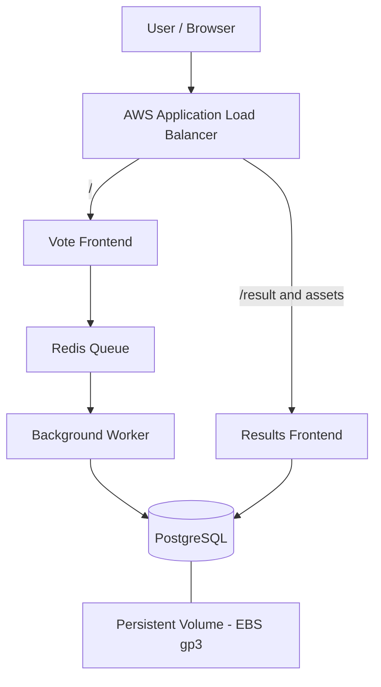

# Voting App — DevOps Capstone 1

A containerized, Kubernetes-deployed voting application demonstrating infrastructure provisioning with Terraform, container image delivery with GitHub Actions, vulnerability scanning with Trivy, application deployment with Helm, persistent storage, AWS EKS, and rollback-based recovery.

## Live Application

| Component | Link |
|---|---|
| 🗳️ Vote page | [Open Voting App](http://k8s-votingap-votingap-c1675d400d-707998152.us-east-1.elb.amazonaws.com/) |
| 📊 Results page | [View Results](http://k8s-votingap-votingap-c1675d400d-707998152.us-east-1.elb.amazonaws.com/result) |

Both application pages are served through the same AWS Application Load Balancer (ALB).

> **Note:** The links use HTTP and the ALB hostname. The application is a demonstration deployment, not a production-secured service.

## 1. Project Overview

The application allows users to vote for Cats or Dogs and displays the results.

The project focuses on taking an application from local container execution to an automated cloud deployment, including infrastructure, CI/CD, image security scanning, persistent storage, Kubernetes routing, and recovery from a failed release.

### Application flow

1. A user submits a vote through the vote frontend.
2. The vote is placed in Redis.
3. The worker processes the queued vote.
4. PostgreSQL stores the vote data.
5. The results frontend reads and displays the voting totals.

## 2. Architecture



### Technology stack

| Area | Technology |
|---|---|
| Application | Python, Node.js, Redis, PostgreSQL |
| Containers | Docker |
| Container orchestration | Kubernetes |
| Cloud platform | AWS |
| Kubernetes service | Amazon EKS |
| Infrastructure as Code | Terraform |
| Application packaging | Helm |
| Container registry | Docker Hub |
| CI/CD | GitHub Actions |
| Vulnerability scanning | Trivy |
| Storage | Amazon EBS, gp3 StorageClass |
| External access | AWS Application Load Balancer Controller |

## 3. Infrastructure Provisioning

Terraform provisions the AWS infrastructure used to run the application.

**Cluster details**

- Cluster name: `voting-app-eks`
- AWS region: `us-east-1`
- Kubernetes namespace: `voting-app`
- Worker node instance type: `t3.medium`
- Desired worker nodes: `2`
- Kubernetes application deployment managed by Helm

Terraform was used to define and provision the infrastructure rather than creating the entire environment manually.

### Useful commands

```bash
terraform init
terraform fmt -check
terraform validate
terraform plan
terraform apply
```

Run Terraform commands from the capstone's Terraform directory. Review the plan before applying infrastructure changes.

## 4. Kubernetes Deployment with Helm

The application is packaged in the Helm chart located at:

```text
helm/voting-app/
├── Chart.yaml
├── values.yaml
└── templates/
    ├── _helpers.tpl
    ├── vote.yaml
    ├── result.yaml
    ├── worker.yaml
    ├── redis.yaml
    └── db.yaml
```

The chart manages the vote frontend, results frontend, worker, Redis, PostgreSQL, and database persistent storage.

### Deploy or upgrade the application

```bash
helm lint ./helm/voting-app

helm upgrade --install voting-app ./helm/voting-app \
  --namespace voting-app \
  --create-namespace \
  --wait \
  --timeout 5m
```

### Verify the deployment

```bash
kubectl get nodes
kubectl get pods -n voting-app
kubectl get services -n voting-app
kubectl get pvc -n voting-app
kubectl get ingress -n voting-app
```

The application has been verified running in EKS, with all five application pods reaching the `Running` state and the PostgreSQL persistent volume claim becoming `Bound`.

## 5. Shared ALB Ingress

The Ingress resource is maintained at:

```text
k8s/voting-app-ingress.yaml
```

Ingress name: `voting-app-ingress`

Ingress class: `alb`

The shared ALB routes requests to the appropriate backend:

| Path | Backend |
|---|---|
| `/` | Vote frontend |
| `/result` | Results frontend |
| `/stylesheets` | Results frontend assets |
| `/socket.io.js` | Results frontend Socket.IO client |
| `/socket.io` | Results frontend Socket.IO connection |
| `/angular.min.js` | Results frontend assets |
| `/app.js` | Results frontend assets |
| `/index.html` | Results frontend |

A URL-rewrite transform maps `/result` to the result application's root path. Explicit asset paths ensure the browser loads the result frontend's JavaScript, stylesheets, and Socket.IO client through the same ALB.

### Verify public routing

```bash
ALB="http://k8s-votingap-votingap-c1675d400d-707998152.us-east-1.elb.amazonaws.com"

curl -s -o /dev/null -w "Vote page: %{http_code}\n" "$ALB/"
curl -s -o /dev/null -w "Result page: %{http_code}\n" "$ALB/result"
curl -s -o /dev/null -w "Socket.IO client: %{http_code}\n" "$ALB/socket.io.js"
curl -s -o /dev/null -w "Angular: %{http_code}\n" "$ALB/angular.min.js"
curl -s -o /dev/null -w "Result JavaScript: %{http_code}\n" "$ALB/app.js"
curl -s -o /dev/null -w "Result CSS: %{http_code}\n" "$ALB/stylesheets/style.css"
```

All six endpoints returned `200 OK` during verification. End-to-end voting was also tested successfully through the live application.

## 6. CI/CD Pipeline

Workflow file:

```text
.github/workflows/ci-cd.yaml
```

The GitHub Actions pipeline automates the container delivery and deployment process.

### Pipeline stages

1. Check out the repository.
2. Set up Docker Buildx.
3. Build the vote, result, and worker images.
4. Run Trivy vulnerability scans.
5. Push images to Docker Hub with commit-SHA and `latest` tags on the configured main-branch push workflow.
6. Deploy the updated application to EKS using the configured deployment workflow.

### Container images

```text
pharmakarios1/voting-app-vote
pharmakarios1/voting-app-result
pharmakarios1/voting-app-worker
```

Commit-SHA tags make it possible to identify the image built from a particular revision of the repository.

### Required GitHub configuration

Configure credentials and deployment settings as GitHub Actions Secrets or Variables, as appropriate for the workflow. Never commit real credentials to the repository.

## 7. Container Security with Trivy

Trivy scans the application container images for vulnerabilities.

The configured scan uses:

```yaml
- name: Run Trivy Vulnerability Scanner
  uses: aquasecurity/trivy-action@v0.36.0
  with:
    image-ref: '${{ secrets.DOCKER_USERNAME }}/voting-app-${{ matrix.service }}:${{ github.sha }}'
    format: table
    scanners: vuln
    severity: CRITICAL,HIGH
    ignore-unfixed: true
    trivyignores: .trivyignore
    exit-code: '0'
```

The scan is configured to:

- Report CRITICAL and HIGH severity vulnerabilities.
- Ignore vulnerabilities without available fixes.
- Apply the project's `.trivyignore` exclusions.
- Display findings in table format.

**Security note:** `exit-code: '0'` allows the workflow to continue even when matching vulnerabilities are found. The scan provides visibility but does not currently enforce a blocking vulnerability threshold.

## 8. Persistent Storage

PostgreSQL uses a PersistentVolumeClaim backed by Amazon EBS.

Verified storage configuration:

- StorageClass: `gp3`
- Requested capacity: `1Gi`
- Access mode: `ReadWriteOnce`
- Provisioner: EBS CSI driver
- PVC status: `Bound`

This gives PostgreSQL persistent storage beyond the lifetime of an individual database pod. Actual data durability also depends on the volume lifecycle, backup strategy, and recovery configuration.

## 9. Helm Failure and Rollback Exercise

A deliberate Helm upgrade was used to demonstrate recovery from a failed application release.

The test deployed an invalid vote image tag:

```bash
helm upgrade voting-app ./helm/voting-app \
  -n voting-app \
  --reuse-values \
  --set vote.image.tag=rollback-practice-invalid \
  --wait \
  --timeout 2m
```

The invalid image caused the vote deployment to fail, with the affected pod entering `ImagePullBackOff`.

The application was recovered by rolling back to a known-good Helm revision:

```bash
helm rollback voting-app 6 \
  -n voting-app \
  --wait \
  --timeout 5m
```

Helm created revision 13 as the deployed rollback revision. The application pods returned to `Running` with readiness checks passing.

### Inspect release history

```bash
helm history voting-app -n voting-app
helm status voting-app -n voting-app
kubectl get pods -n voting-app
```

This exercise demonstrates the ability to identify a failed release, restore a previous working configuration, and verify application recovery.

## 10. Project Verification Checklist

- [x] Fork and clone the Voting App repository.
- [x] Run the application locally with Docker Compose.
- [x] Complete container hardening.
- [x] Provision EKS infrastructure with Terraform.
- [x] Deploy the application with Helm.
- [x] Configure PostgreSQL persistent storage.
- [x] Configure shared ALB path-based routing.
- [x] Verify the vote and results pages through the ALB.
- [x] Verify end-to-end voting works.
- [x] Automate image build, scan, push, and deployment.
- [x] Restore Trivy scanning in the GitHub Actions workflow.
- [x] Demonstrate a failed Helm release and successful rollback.
- [ ] Capture and attach final screenshots and command outputs as project evidence.
- [ ] Review IAM permissions and evaluate GitHub Actions OIDC federation as an authentication improvement.

## 11. Project Evidence

Capture the following evidence for the repository README, portfolio, or project submission.

| Evidence | What to capture |
|---|---|
| Live vote page | Browser showing the Cats vs Dogs voting interface |
| Live results page | Browser showing voting totals |
| End-to-end voting | Vote submission and corresponding updated result |
| Terraform | Successful validation and relevant apply output |
| EKS | `kubectl get nodes` showing Ready nodes |
| Workloads | `kubectl get pods -n voting-app` showing healthy pods |
| Storage | `kubectl get pvc -n voting-app` showing the Bound database claim |
| Ingress | `kubectl get ingress -n voting-app` showing the ALB hostname |
| CI/CD | Successful GitHub Actions run showing build, scan, push, and deployment stages |
| Trivy | Scan output showing vulnerability findings or a clean scan |
| Helm history | `helm history voting-app -n voting-app` showing the failed release and subsequent rollback |
| Recovery | `kubectl get pods -n voting-app` showing healthy pods after rollback |

Suggested evidence directory:

```text
docs/
└── evidence/
    ├── vote-page.png
    ├── results-page.png
    ├── end-to-end-voting.png
    ├── terraform-validation.png
    ├── eks-nodes.png
    ├── healthy-pods.png
    ├── persistent-volume.png
    ├── alb-ingress.png
    ├── github-actions-pipeline.png
    ├── trivy-scan.png
    └── helm-rollback.png
```

Only add screenshots after capturing the corresponding results. Do not commit AWS credentials, Docker Hub passwords, Kubernetes secrets, Terraform state files, or other sensitive data as evidence.

## 12. Lessons Learned

This capstone provided practical experience with:

- Containerizing and hardening a multi-service application.
- Provisioning cloud infrastructure using Terraform.
- Deploying and operating Kubernetes workloads on Amazon EKS.
- Packaging applications with Helm.
- Configuring persistent storage through EBS CSI.
- Routing multiple frontend paths through a shared AWS ALB.
- Automating image builds, vulnerability scans, image publishing, and application deployment.
- Recovering from failed Helm releases using rollback.
- Verifying an application across its frontend, queue, worker, database, and results components.

## Conclusion

The Voting App capstone demonstrates an end-to-end DevOps workflow: infrastructure as code, containerization, Kubernetes orchestration, automated delivery, vulnerability scanning, persistent storage, ingress routing, and release recovery.

The application is running on Amazon EKS, and the vote and results pages are accessible through the shared ALB.

**Live demo:** [Vote](http://k8s-votingap-votingap-c1675d400d-707998152.us-east-1.elb.amazonaws.com/) | [Results](http://k8s-votingap-votingap-c1675d400d-707998152.us-east-1.elb.amazonaws.com/result)
